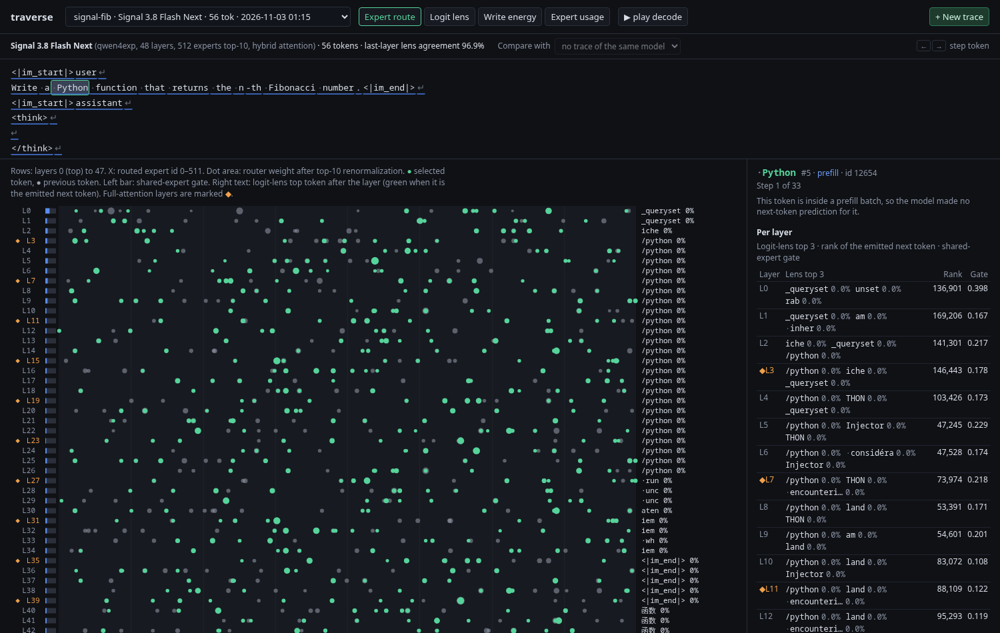

# lanternfish

See how a language model processes a prompt, token by token and layer by
layer.

lanternfish runs a model in llama.cpp, records what happens inside each
layer for each token, and shows the result in a browser. It works with any
model that llama.cpp can load from a GGUF file, dense or mixture-of-experts.
It has no model-specific code.



## What it shows

For every token, in prompt processing (prefill) and in decoding:

- **Expert route** (mixture-of-experts models): the experts that the router
  selects in each layer, with their weights. You can step through the
  tokens and see how the route changes.
- **Logit lens**: the tokens that the model already predicts after each
  layer. A heatmap shows the layer at which each prediction forms.
- **Write energy**: how much each layer changes each token's internal
  state.
- **Expert usage**: how the load spreads over the experts, in prefill and
  in decoding.
- **Compare**: two traces of the same model, side by side or as a
  difference.

You can start new traces from the browser and watch their progress.

## Quick start with Docker

```sh
git clone https://github.com/Quat3rnion/lanternfish
cd lanternfish
docker build -t lanternfish .
docker run -d --name lanternfish -p 8791:8791 \
  -v /path/to/your/models:/models:ro \
  -v lanternfish-data:/data \
  lanternfish
```

Open `http://localhost:8791/`, click **New trace**, select a model, and
type a prompt.

With Compose:

```sh
LANTERNFISH_MODELS_DIR=/path/to/your/models docker compose up -d
```

The first build compiles llama.cpp and takes about 5 to 15 minutes.

## Quick start without Docker

You need Rust 1.88 or later, Node.js 20 or later, libclang, and llama.cpp
(shared libraries and headers). Full steps: [INSTALL.md](INSTALL.md).

```sh
npm --prefix web ci && npm --prefix web run build
cargo build --release
target/release/lanternfish probe MODEL.gguf
target/release/lanternfish run MODEL.gguf --name first --prompt "Write a Python function that reverses a list."
target/release/lanternfish serve --models-dir /path/to/models
```

## Commands

| Command | What it does |
|---|---|
| `lanternfish probe MODEL` | Runs one small forward pass. Shows which internal values the model provides. Use it first on a new architecture. |
| `lanternfish run MODEL --name N --prompt P` | Makes a trace: the prompt plus `-n` generated tokens (default 64). |
| `lanternfish list` | Lists the traces. |
| `lanternfish serve` | Starts the web UI and the HTTP API on port 8791. |

All options: [docs/USAGE.md](docs/USAGE.md).

## Tested models

| Model | Type | Lens agreement | Trace time |
|---|---|---|---|
| Llama 3.2 3B Instruct, Q4_K_M | dense | 1.000 | 6 s, 70 tokens |
| Qwen3.5-4B, Q4_K_M | dense, hybrid attention | 0.887 | 7 s, 72 tokens |
| Signal-3.8-Flash-Next (125B), Q8_0 | 512-expert MoE, hybrid attention, hyper-connections | 0.969 | 180 s, 56 tokens |

"Lens agreement" is the share of positions where the lens at the last
layer predicts the token that the model actually generated. A value near 1
shows that the lens reads the model correctly. Times are on a 32-thread CPU
(AMD Ryzen AI MAX+ 395), with 16 threads.

## How it works

lanternfish loads the GGUF through llama.cpp on the CPU and installs a
callback that sees every node of the compute graph. It keeps a small set of
nodes by name (for example `l_out` for the residual stream and
`ffn_moe_topk` for the selected experts). Then it computes the logit lens
with the model's own output head. Details:
[docs/ARCHITECTURE.md](docs/ARCHITECTURE.md).

## Limits

- CPU only. Decoding is greedy.
- The trace shows the GGUF file that you give it, run by llama.cpp. Another
  runtime or another quantization of the same model can behave differently.
- Lens probabilities are calibrated only when the model's output path is
  "final norm, then output head". For other models, use the rank of the
  next token, which is always correct.
- The web server has no authentication. Expose it on a trusted network
  only.

## Documentation

| Document | For |
|---|---|
| [INSTALL.md](INSTALL.md) | Installing with Docker or from source, with a check after each step |
| [docs/USAGE.md](docs/USAGE.md) | Every command and option, the UI, the HTTP API |
| [docs/DOCKER.md](docs/DOCKER.md) | Image details, volumes, llama.cpp version, GPU notes |
| [docs/ARCHITECTURE.md](docs/ARCHITECTURE.md) | How a trace is made, and how to support a new model architecture |
| [docs/FORMAT.md](docs/FORMAT.md) | The trace file format |
| [web/README.md](web/README.md) | Developing the UI |

## Contributing

Bug reports and pull requests are welcome on
[GitHub](https://github.com/Quat3rnion/lanternfish/issues). Before you send
a pull request, run:

```sh
cargo fmt --check
cargo clippy --release --all-targets
cargo test --release
npm --prefix web run check
```

To support a new model architecture, read
[docs/ARCHITECTURE.md](docs/ARCHITECTURE.md) first. Usually you only add
node names.

## License

Copyright 2026 quaternion.

Licensed under the Apache License, Version 2.0. See [LICENSE](LICENSE).
Unless you explicitly state otherwise, any contribution that you submit for
inclusion in this project is licensed under the same terms, without any
additional terms or conditions.

lanternfish links to [llama.cpp](https://github.com/ggml-org/llama.cpp) and
ggml, which are under the MIT license.
